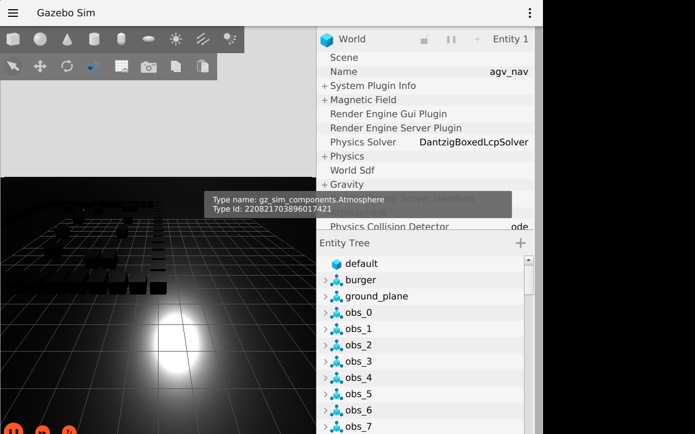
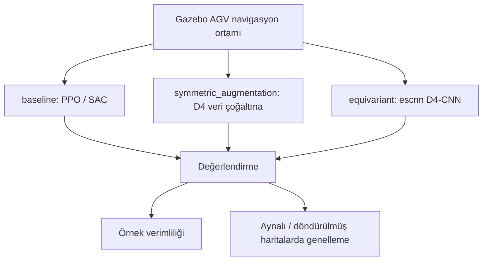

# Symmetry-Exploiting DRL for AGV Path Planning

**AGV navigasyonunda D4 simetrisini (4 rotasyon × ayna) kullanan derin pekiştirmeli öğrenme politikasının, simetri bilgisiz baseline ile karşılaştırıldığı makale çalışması.**

Hedef dergi: *Symmetry* (MDPI). Üç kol karşılaştırılır: düz PPO/SAC (baseline), D4 ile veri çoğaltma (symmetric augmentation) ve E(2)-steerable eşdeğişken CNN (equivariant).


*Gazebo depo ortamında AGV navigasyon sahnesi.*

## Özet

| | |
|---|---|
| **Problem** | AGV yol planlamasında simetriyi kullanarak örnek verimliliği ve görülmemiş (aynalı/döndürülmüş) haritalarda genellemeyi artırmak |
| **Yöntem** | 3 kol: baseline, symmetric_augmentation, equivariant (escnn D4-CNN); PPO/SAC |
| **Simülasyon / donanım** | Gazebo AGV navigasyon ortamı (`Simulations/gazebo_agv_nav`); Isaac Sim denendi, GPU/sürücü uyumsuzluğu nedeniyle terk edildi |
| **Makale** | `Paper/` — TODO: taslak PDF eklenecek |

### Sistem mimarisi


*TODO: `assets/architecture.png` — baseline / augmentation / equivariant kollarını gösteren blok şeması eklenecek.*

Devir notu ve karar geçmişi: [Resources/HANDOFF.md](Resources/HANDOFF.md).

### Akış şeması (nasıl çalışır)



Aynı ortamda üç kol eğitilir ve iki ölçüt üzerinden karşılaştırılır; sim-to-real aşaması henüz başlamadı.

## Seçilmiş sonuçlar

Eğitim devam ediyor / durduruldu (durum için `Resources/HANDOFF.md`). Henüz makaleye girecek nihai sonuç grafiği yok.
*TODO: `plots/sonuc_1.png` (örnek verimliliği), `plots/sonuc_2.png` (genelleme) eklenecek.*

*Tüm şekiller `plots/` klasöründe tutulacaktır.*

## Kurulum

### Gereksinimler
- Linux, Python 3.x, Gazebo; GPU önerilir (eğitim için)
- `escnn` (equivariant kol için)

### Adımlar
```bash
git clone https://github.com/GulogluHaktan/AGV.git
cd AGV
# TODO: requirements.txt eklenecek (şu an yok)
```

## Kullanım

Eğitim ve değerlendirme betikleri `RL/training`, `RL/eval` ve `Simulations/gazebo_agv_nav` altındadır.
*TODO: tek komutluk "hazır modeli çalıştır" ve beklenen çıktı eklenecek.*

## Sonuçları yeniden üret

| Şekil | Komut |
|---|---|
| `plots/sonuc_1.png` | TODO |

## Proje yapısı

```
AGV_AGR_Paper/
├── RL/                  # agents, training, eval
├── Simulations/         # gazebo_agv_nav, isaac_agv_nav
├── Paper/               # makale taslağı
├── Resources/           # HANDOFF.md, CLAUDE.md, Mission
├── Outputs/  Scripts/   # çıktılar, yardımcı betikler
├── assets/              # README görselleri
└── README.md
```

## Atıf, lisans, iletişim

```bibtex
@misc{agvsym2026,
  title  = {Symmetry-Exploiting DRL for AGV Path Planning},
  author = {Haktan G{\"u}lo{\u{g}}lu},
  year   = {2026},
  url    = {https://github.com/GulogluHaktan/AGV}
}
```
Lisans: TODO. İletişim: MTA Yapay Zeka Merkezi, Haktan Güloğlu.
