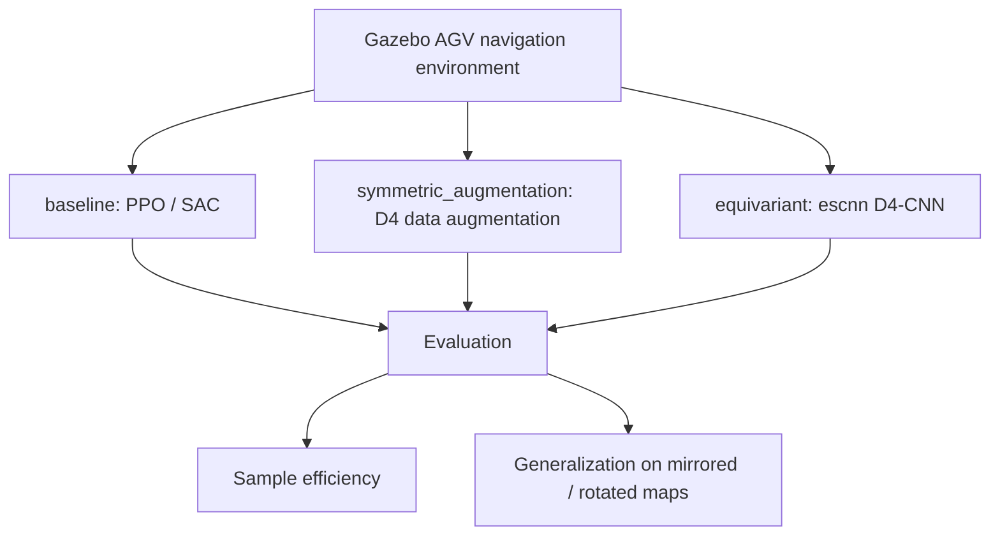

🇬🇧 English · 🇹🇷 [Türkçe](README.tr.md)

# Symmetry-Exploiting DRL for AGV Path Planning

**A paper project comparing a deep-RL policy that exploits D4 symmetry (4 rotations × mirror) in AGV navigation against a symmetry-unaware baseline.**

Target journal: *Symmetry* (MDPI). Three arms are compared: plain PPO/SAC (baseline), D4 data augmentation (symmetric augmentation) and an E(2)-steerable equivariant CNN (equivariant).


*AGV navigation scene in the Gazebo warehouse environment.*

## Summary

| | |
|---|---|
| **Problem** | Using symmetry in AGV path planning to improve sample efficiency and generalization to unseen (mirrored/rotated) maps |
| **Method** | 3 arms: baseline, symmetric_augmentation, equivariant (escnn D4-CNN); PPO/SAC |
| **Simulation / hardware** | Gazebo AGV navigation environment (`Simulations/gazebo_agv_nav`); Isaac Sim was tried and abandoned due to GPU/driver incompatibility |
| **Paper** | `Paper/` — TODO: add draft PDF |

### System architecture


*TODO: add `assets/architecture.png` — block diagram of the baseline / augmentation / equivariant arms.*

Handover note and decision history: [Resources/HANDOFF.md](Resources/HANDOFF.md) (Turkish).

### Flow diagram (how it works)



Three arms are trained in the same environment and compared on two criteria; the sim-to-real stage has not started yet.

## Selected results

Training is in progress / paused (see `Resources/HANDOFF.md`). There are no final result plots for the paper yet.
*TODO: add `plots/sonuc_1.png` (sample efficiency) and `plots/sonuc_2.png` (generalization).*

*All figures will be kept in the `plots/` folder.*

## Installation

### Requirements
- Linux, Python 3.x, Gazebo; GPU recommended (training)
- `escnn` (for the equivariant arm)

### Steps
```bash
git clone https://github.com/GulogluHaktan/AGV.git
cd AGV
# TODO: add requirements.txt (none yet)
```

## Usage

Training and evaluation scripts are under `RL/training`, `RL/eval` and `Simulations/gazebo_agv_nav`.
*TODO: add a one-command "run the ready model" and expected output.*

## Reproducing the results

| Figure | Command |
|---|---|
| `plots/sonuc_1.png` | TODO |

## Project structure

```
AGV_AGR_Paper/
├── RL/                  # agents, training, eval
├── Simulations/         # gazebo_agv_nav, isaac_agv_nav
├── Paper/               # paper draft
├── Resources/           # HANDOFF.md, CLAUDE.md, Mission
├── Outputs/  Scripts/   # outputs, helper scripts
├── assets/              # README images
└── README.md
```

## Citation, license, contact

```bibtex
@misc{agvsym2026,
  title  = {Symmetry-Exploiting DRL for AGV Path Planning},
  author = {Haktan G{\"u}lo{\u{g}}lu},
  year   = {2026},
  url    = {https://github.com/GulogluHaktan/AGV}
}
```
License: TODO. Contact: MTA Artificial Intelligence Center, Haktan Güloğlu.
